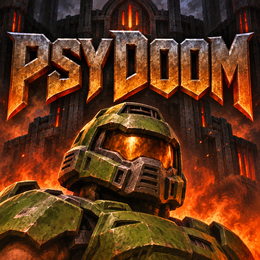

# PsyDoom for PS4

A native OpenOrbis PS4 port of [PsyDoom](https://github.com/BodbDearg/PsyDoom),
with Vulkan rendering through OpenGNM and PSBC. Original PsyDoom work and
history are preserved; see [upstream documentation](README.upstream.md) and
[contributors](CONTRIBUTORS.md).



## Status

Gameplay, keyboard-to-controller input and normal game timing have been tested
in shadPS4. **Physical PS4 testing is pending.** Emulator results do not establish
console compatibility. The source includes later packaging/resource-search
changes; each release documents its own test status.

Game disc data is not included. Use your own supported PlayStation Doom disc
image. This is an unofficial port, not an id Software or Sony product.

## Install and game data

Install the release PKG. Put the CUE file and every referenced BIN file together
in one of these folders, searched in order:

1. HDD: `/data/psydoom/disc/`
2. USB0: `/mnt/usb0/psydoom/disc/`
3. USB1: `/mnt/usb1/psydoom/disc/`

On USB, create `psydoom/disc/` at the drive root. `Doom.cue` is preferred;
other `.cue` names are supported. Unusable disc descriptions are skipped.
Leave USB connected while playing. Configuration, saves and logs stay under
`/data/psydoom` on HDD. See [installation details](ps4/INSTALL-0.02.txt).

## Controls

| Action | PS4 controller | shadPS4 default keyboard |
|---|---|---|
| Move | Left stick | WASD |
| Turn | Right stick | IJKL |
| Fire / punch | R2 or Triangle | O or C |
| Use / open door | Circle | B |
| Previous / next weapon | L1 / R1 | Q / U |
| Confirm | Cross | N |
| Pause / start | Options | Enter |

## Build

See [PS4 build instructions](ps4/README.md). All locally modified graphics
library sources are included in `third_party_ps4`, with revisions, licenses,
patches and SHA256 checksums. No ScummVM checkout is required.

```sh
export OO_PS4_TOOLCHAIN=/path/to/OpenOrbis/PS4Toolchain
bash scripts/ps4/build.sh
python3 scripts/ps4/package.py --output-dir dist/local
```

## License and source

PsyDoom is distributed under [GNU GPLv3](LICENSE). Preserve original notices;
third-party components retain their own licenses. See
[third-party sources](third_party_ps4/README.md). Disc images, original game
music and artwork are not granted by this source-code license and are not
included in the package. The launcher icon is generated artwork; its source
and [generation prompt](ps4/assets/ICON-PROMPT.txt) are included.

When distributing a PKG, make its corresponding source, local library changes,
and build instructions available alongside it. Tag the exact source revision
and attach its source archive to the release. Do not substitute a rebuilt PKG
for an already tested artifact without identifying the change.
