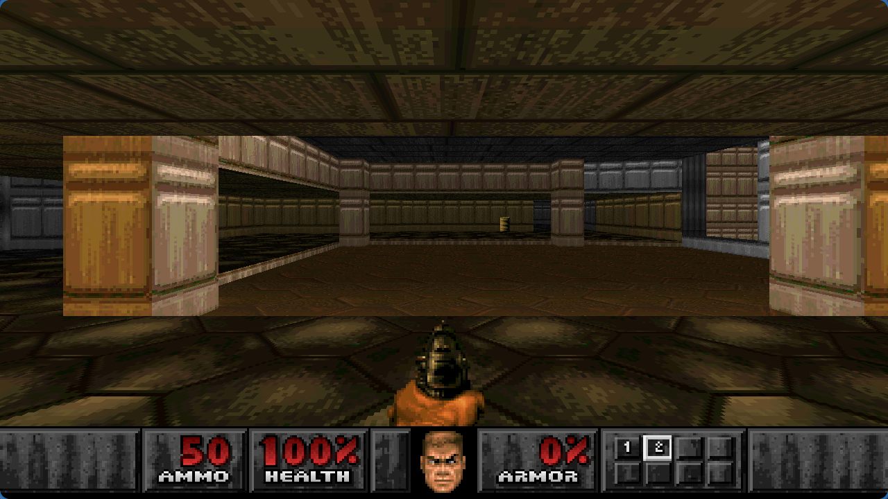
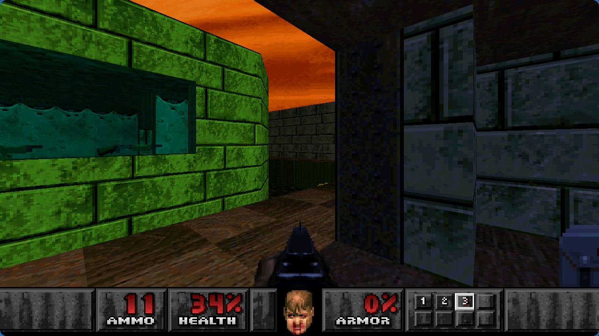
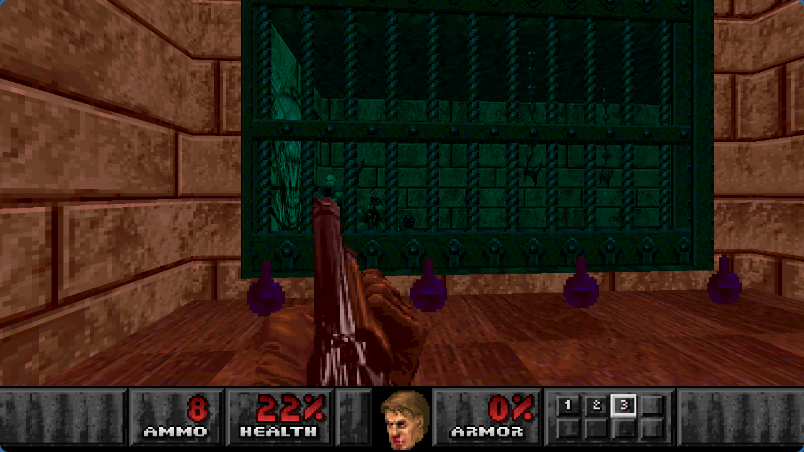
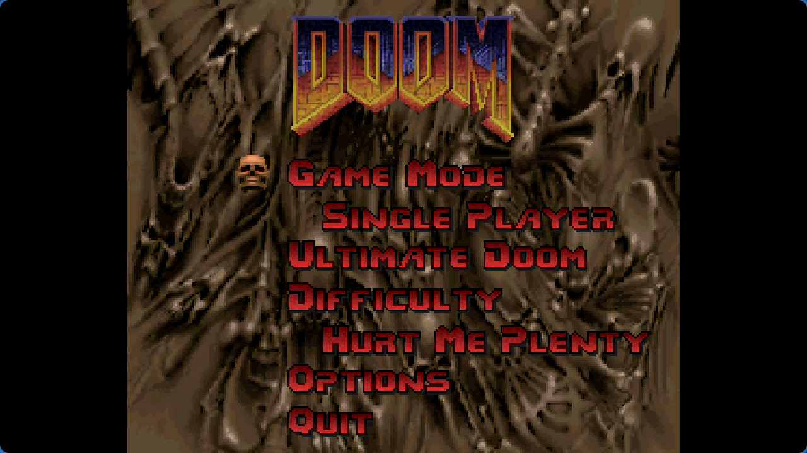

# PsyDoom PS4 screenshots

Captured from the PS4 0.02 build running in shadPS4 v0.18.0 on Wayland.
These are emulator captures, not photos or captures from a physical PS4.
The firmware 13.52 compatibility report is a separate community user report.

Captured at 1280 × 720 on 2026-11-10 from the staged payload of the published
0.02 package (source revision `02779762e8754cf15d44343c87556ce2e60ba73e`).
Package SHA-256: `e6d9052d6610a9cddee244d442ccc5d703ec279353df3e1c789f79423c765147`.

## First level

## Combat

## Menu

Game artwork belongs to its respective rights holders. Game data is not included
with the source code or release package.
